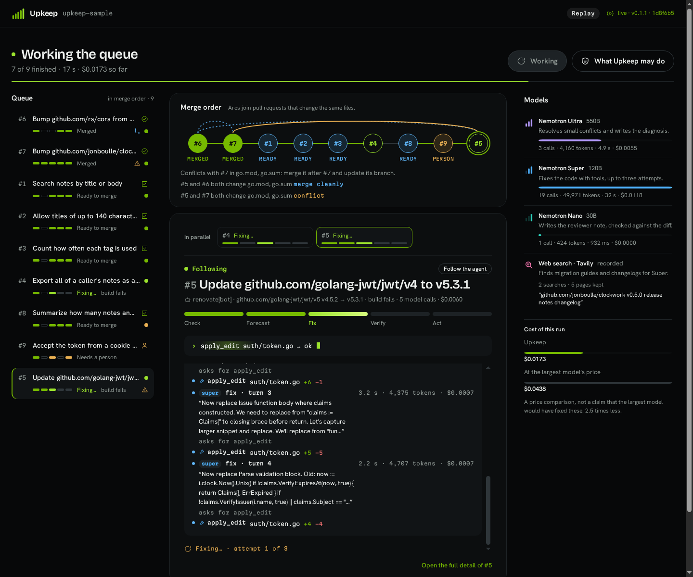
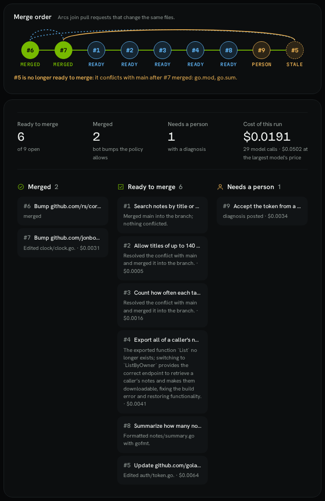
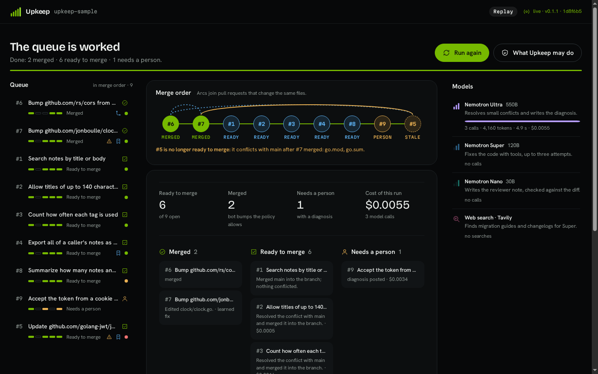

# Upkeep

[](https://github.com/aalvaropc/upkeep/actions/workflows/ci.yml)

Upkeep keeps GitHub pull requests mergeable. It looks at the whole queue of open pull requests, plans the order they can merge in, fixes what a bounded policy allows, proves every fix with the compiler and the tests, remembers the fixes that passed, and hands the rest back with a diagnosis and a receipt that says what each model did and cost.

It runs on NVIDIA Nemotron models (Ultra, Super and Nano) served by Nebius Token Factory, and reads migration guides found with Tavily. It is written in Go and ships as one binary with its dashboard built in.


## What it does

A repository collects pull requests that need a small change before anyone can merge them: the branch is behind, a conflict touches one line, a rename on `main` broke the build, a Dependabot bump no longer compiles, `gofmt` complains, a flaky test fails. Upkeep works through them:

1. **Plan.** Before touching any code it finds which open pull requests change the same files and which pairs would conflict (`git merge-tree`), and suggests a merge order. After the run it checks the ready ones again and flags any that the run's own merges made stale.
2. **Detect.** It merges the base branch into a scratch copy and runs the build, vet and tests in a container without network access. The first thing that fails is the blocker: behind, a small or a large conflict, build, test, formatting or a flaky test.
3. **Forecast** (dependency upgrades). It searches the web with Tavily for the migration guide, reads the release notes, asks Super what will break in the identifiers this project uses, and later marks each prediction confirmed or not seen by the build.
4. **Fix.** Merges and formatting are mechanical. Small conflicts go to Ultra in one call. Broken builds and tests go to Super, which edits files through four tools (`read_file`, `apply_edit`, `go_doc`, `run_checks`) for up to three attempts, each starting clean.
5. **Verify.** Outside the model, a checklist decides: build, vet and tests pass; at most 5 files and 80 lines changed; no test touched; Go files only; no comment added; formatted.
6. **Act.** Push the fix when the pull request has the `upkeep` label or is a bot's, otherwise attach it as a patch; merge a bot's patch or minor bump when everything passes; otherwise post Ultra's diagnosis and leave the pull request to a person. Every ready pull request gets a merge confidence (high, medium or low) with the facts behind it.
7. **Learn.** A fix Super made that passed the verifier is remembered with its failure. When the same failure comes back for the same dependency jump, Upkeep reapplies those edits first, with no model call, and still runs every check and the verifier; if they fail, it repairs from the start.

Upkeep never force-pushes, never merges a pull request opened by a person, and never lets a fix edit, delete or skip tests. Those are rules in code, not in a prompt.

## See the agent work

While the queue runs, the centre of the screen is a live stage: the pull request the agent is working, its five stages, the latest thing that happened, and the trace as it grows: the plan, the Tavily search, every Super turn with the tool it asked for and the file it edited, each attempt with why it failed, the verifier and the action. Click a pull request in the queue to follow it instead:



The full detail of a pull request opens in a side sheet; its Summary tab keeps what a reviewer needs: what changed, the merge confidence and its reasons, the forecast with each prediction confirmed or not seen by the build and where the sources came from, the diff, the verifier and the receipt.


When the run ends, the centre shows the results: the run's figures, the merge order Upkeep planned, and what it did grouped into merged, ready and needs a person. In the scenario the jwt and clockwork bumps both edit `go.mod`; Upkeep merges clockwork first and, after the run, says the jwt upgrade now needs its branch updated:



Press **Run again** and the next run keeps what this one learned: the three fixes Super made are reapplied with zero model calls and still go through every check, and the run costs $0.0055 instead of $0.0191.



## The demo scenario

`upkeep-sample` is a small Go service with nine open pull requests built to show one blocker each. The result of replaying the recorded run (see [`docs/evals/latest.md`](docs/evals/latest.md)):

| # | Pull request | Blocker | Result |
|---|---|---|---|
| 1 | Search notes | behind `main` | patch attached |
| 2 | Longer titles (`upkeep` label) | one-line conflict | resolved by Ultra, pushed |
| 3 | Tag counts | conflicting imports | resolved by Ultra, patch attached |
| 4 | Notes export (`upkeep` label) | `main` renamed a method it calls | fixed by Super, pushed |
| 5 | jwt v4 to v5 (bot, major) | build fails | fixed by Super, pushed, left for a person; low merge confidence and flagged stale after #7 merged |
| 6 | cors patch bump (bot) | none | merged, no model call |
| 7 | clockwork minor bump (bot) | build fails | fixed by Super, pushed, merged first by the plan |
| 8 | Note summary | formatting, and a test that depends on order | formatted, patch attached, the flaky test reported and left alone |
| 9 | Auth rewrite | four overlapping conflict hunks | handed back with Ultra's diagnosis |

The whole run costs about two cents: $0.0191 against $0.0502 for the same tokens at the largest model's price. That is a price comparison, not a claim that the largest model would have fixed them. CI replays the recording and fails if any pull request ends differently.

The recording is one run, so it was also measured live: five runs against the real models (nothing replayed) ended with all 45 pull requests as the scenario expects, at $0.020 to $0.037 a run ([`docs/evals/live.md`](docs/evals/live.md)). Three more live runs on 2026-10-29, with the plan, the fresh Tavily searches and the learned fixes in place, ended 27 of 27 at $0.0230 a run.

It also runs on real pull requests: as a GitHub Action on the sample repository it brought the two pull requests Dependabot had opened up to date, saw that they conflict with each other, let GitHub merge one, then had Ultra resolve the other's conflict for $0.0006 ([`docs/evals/action.md`](docs/evals/action.md)).

## Run it

Replay needs no key and no network to the models. You need Go 1.26, Node.js 22.12 (pinned in `web/.tool-versions`) and Docker.

```sh
make build
UPKEEP_MODE=replay UPKEEP_DATA_DIR=data ./bin/upkeep demo
```

Open http://127.0.0.1:8080 and press **Work the queue**. The recording built into the binary answers every model call, so the nine pull requests finish with the same outcomes and costs as when they were recorded. `-pace 0` skips the recorded latencies.

With a Token Factory key the same page runs live:

```sh
export NEBIUS_API_KEY=...        # https://tokenfactory.nebius.com
export TAVILY_API_KEY=...        # optional: web search for migration guides
UPKEEP_MODE=live ./bin/upkeep demo
```

Work a real repository (needs a model key; a dry run of a public repository needs no GitHub token):

```sh
./bin/upkeep run -repo owner/name -dry-run      # detect and fix locally, change nothing
GITHUB_TOKEN=... ./bin/upkeep run -repo owner/name
```

The same run works from GitHub Actions: `uses: aalvaropc/upkeep@v0.1.0` on a daily schedule, from the Actions tab or from a `/upkeep` comment on a pull request ([`docs/action.md`](docs/action.md)).

| Command | What it does |
|---|---|
| `upkeep demo` | serves the dashboard with isolated sessions of the nine-pull-request scenario |
| `upkeep run -repo owner/name` | works the open pull requests of a GitHub repository (`-dry-run` changes nothing, `-pr 9,11` picks pull requests) |
| `upkeep record -fixtures DIR` | runs the scenario with the real models and saves every exchange |
| `upkeep eval [-runs N]` | runs the scenario (replay by default) and writes the outcomes and costs under `docs/evals` |
| `upkeep scenario build -out DIR` | builds the scenario's repository from its recipes |
| `upkeep serve` | the bare dashboard and event stream |

## Nebius Token Factory and NVIDIA Nemotron

Every model call goes to Nebius Token Factory through its OpenAI-compatible API, and each step goes to the Nemotron model that measured best for it:

| Model | Used for | Why |
|---|---|---|
| Nemotron Ultra (550B) | resolves small conflicts in one call; writes the diagnosis when a person is needed | one-shot reasoning over a short file; inside a tool loop it explored and rewrote too much (0 of 21 fixes) |
| Nemotron Super (120B) | fixes builds and tests with tools; reads release notes and search results for the forecast | gave the same forecast three times in a row and fixed the jwt major on the first attempt |
| Nemotron Nano (30B) | writes the one-sentence note for the reviewer | cheap and fast; its note is checked against the diff and dropped if it names anything that is not in the change |

Where Token Factory made the work faster:

- **Routing by measurement.** Three model sizes behind one key and one API let us run 73 experiments (3.06 million tokens, about two dollars) in a day and route each step on evidence instead of guesses. [`docs/models.md`](docs/models.md) has the numbers, including what did not work.
- **Live prices.** `GET /v1/models?verbose=true` returns each model's price, so every receipt is priced from the catalog, and the comparison with the largest model is computed, not assumed.
- **No infrastructure to run.** Inference needs only a key: the demo machine runs the Go binary and the build sandbox, and four pull requests in parallel never came near the rate limits.
- **Reasoning switch.** `chat_template_kwargs: {"enable_thinking": false}` turns reasoning off for the tool loop, where it measured slower and less accurate.

## Tavily

The forecast for a dependency upgrade calls Tavily at runtime to find the migration guide and release notes of the module's own project (other projects' pages are filtered out). The first time a dependency jump is seen, Super writes the forecast from those pages. After that, every live run searches again and shows what it found, including pages that are new, but keeps the forecast a build has already checked: in one live test a fresh search returned weaker pages, the rewritten forecast missed the removed `StandardClaims`, and the fix failed. A forecast is only as good as its pages, so Upkeep does not trade a verified one for an unverified one. The demo starts from the forecasts of its recorded run. The dashboard shows each search (query, pages kept, latency) in the models rail and in the trace, the receipt counts it, and `UPKEEP_SEARCH_DAILY_LIMIT` caps the searches per day. A failed search never fails a pull request: the last forecast is used and the error is shown.

## Documentation

- [`docs/architecture.md`](docs/architecture.md): the pipeline, the packages, the events, record and replay.
- [`docs/policy.md`](docs/policy.md): every rule Upkeep follows and how to change the configurable ones.
- [`docs/models.md`](docs/models.md): what each Nemotron model does, what was measured and what was dropped.
- [`docs/limitations.md`](docs/limitations.md): what Upkeep does not do and where it can be wrong.
- [`docs/action.md`](docs/action.md): the GitHub Action, its secrets, the token it needs and what a run costs.
- [`docs/evals`](docs/evals): the replayed recording, the live runs and the Action on real Dependabot pull requests.
- [`web/DESIGN.md`](web/DESIGN.md): the dashboard's design system.

## Configuration

Settings come from the environment; `.env.example` lists them all.

| Variable | Default | Meaning |
|---|---|---|
| `NEBIUS_API_KEY` | none | Token Factory key; required in `live` and `record` modes |
| `NEBIUS_BASE_URL` | `https://api.tokenfactory.nebius.com/v1` | Token Factory endpoint |
| `UPKEEP_MODEL_ULTRA`, `_SUPER`, `_NANO` | the three Nemotron models | which model plays which role |
| `TAVILY_API_KEY` | none | web search for migration guides; in `live` mode it runs on every dependency forecast |
| `UPKEEP_SEARCH_DAILY_LIMIT` | `100` | live Tavily searches per day; past it the cached forecast is used, and `0` turns the search off |
| `UPKEEP_PRICE_TAVILY_SEARCH` | none | USD per Tavily search, shown on the receipt; without it the receipt counts searches |
| `GITHUB_TOKEN` | none | needed to push to, comment on and merge pull requests |
| `UPKEEP_MODE` | `replay` | `live` calls the models, `record` calls them and saves every exchange, `replay` answers from recorded exchanges |
| `UPKEEP_ADDR` | `127.0.0.1:8080` | address of the dashboard |
| `UPKEEP_DATA_DIR` | `data` | working copies, the build cache and the scenario repository |
| `UPKEEP_SANDBOX` | `docker` | where builds and tests run; `exec` runs them on the host and is for development only |
| `UPKEEP_DAILY_TOKENS` | `1000000` | live tokens per day before runs fall back to replay |
| `UPKEEP_PRICE_<MODEL>_INPUT`, `_OUTPUT` | from the Token Factory catalog | USD per million tokens, to override the catalog |

## Development

`make check` runs what CI runs: formatting, `go mod tidy`, the dependency allowlist, the no-comments rule, `go vet`, golangci-lint, the tests with the race detector, the dashboard's formatting, types and tests, and the build. `make eval` replays the recorded scenario and checks every outcome.

Tests that call Token Factory or GitHub are skipped unless you opt in with `UPKEEP_LIVE_TESTS=1`; they cost a fraction of a cent. Tests that run containers need `UPKEEP_DOCKER_TESTS=1`.

The code has no comments. Names and tests carry the meaning; the only exception is the `//go:embed` directive. `go run ./internal/tools/nocomments .` enforces it for Go and `npm run nocomments` in `web` for the dashboard.

Every pull request targets `main` and is merged with a merge commit once the `pr-targets-main`, `gitleaks`, `test`, `web` and `build` checks pass.

## License

MIT. See [`LICENSE`](LICENSE).
