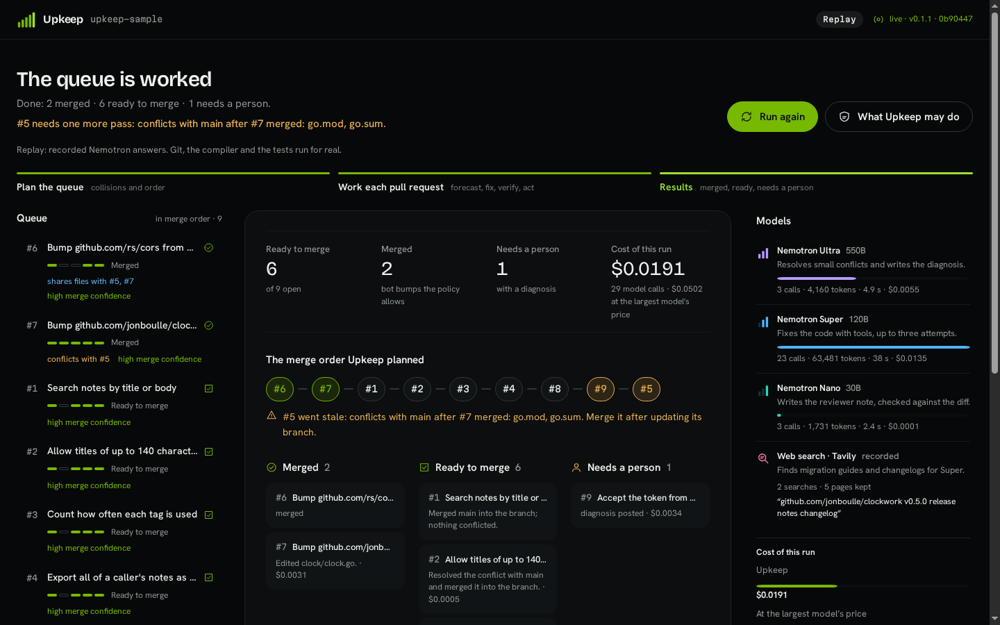
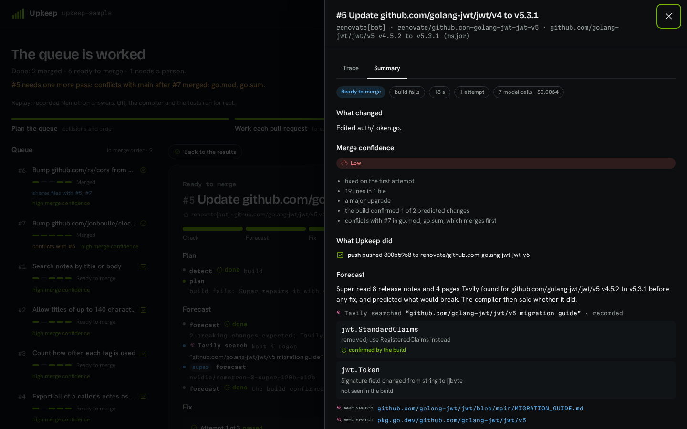

# Upkeep

[](https://github.com/aalvaropc/upkeep/actions/workflows/ci.yml)

Upkeep keeps GitHub pull requests mergeable. It finds what blocks each open pull request, fixes what a bounded policy allows, proves every fix with the compiler and the tests, and hands the rest back with a diagnosis and a receipt that says what each model did and cost.

It runs on NVIDIA Nemotron models (Ultra, Super and Nano) served by Nebius Token Factory. It is written in Go and ships as one binary with its dashboard built in.



## What it does

A repository collects pull requests that need a small change before anyone can merge them: the branch is behind, a conflict touches one line, a rename on `main` broke the build, a Dependabot bump no longer compiles, `gofmt` complains, a flaky test fails. Upkeep works through them:

1. **Detect.** It merges the base branch into a scratch copy and runs the build, vet and tests in a container without network access. The first thing that fails is the blocker: behind, a small or a large conflict, build, test, formatting or a flaky test.
2. **Forecast** (dependency upgrades only). It reads the release notes and the migration guide, asks Super what will break in the identifiers this project uses, and later marks each prediction confirmed or not seen by the build.
3. **Fix.** Merges and formatting are mechanical. Small conflicts go to Ultra in one call. Broken builds and tests go to Super, which edits files through four tools (`read_file`, `apply_edit`, `go_doc`, `run_checks`) for up to three attempts, each starting clean.
4. **Verify.** Outside the model, a checklist decides: build, vet and tests pass; at most 5 files and 80 lines changed; no test touched; Go files only; no comment added; formatted.
5. **Act.** Push the fix when the pull request has the `upkeep` label or is a bot's, otherwise attach it as a patch; merge a bot's patch or minor bump when everything passes; otherwise post Ultra's diagnosis and leave the pull request to a person.

Upkeep never force-pushes, never merges a pull request opened by a person, and never lets a fix edit, delete or skip tests. Those are rules in code, not in a prompt.

## The demo scenario

`upkeep-sample` is a small Go service with nine open pull requests built to show one blocker each. The result of replaying the recorded run (see [`docs/evals/latest.md`](docs/evals/latest.md)):

| # | Pull request | Blocker | Result |
|---|---|---|---|
| 1 | Search notes | behind `main` | patch attached |
| 2 | Longer titles (`upkeep` label) | one-line conflict | resolved by Ultra, pushed |
| 3 | Tag counts | conflicting imports | resolved by Ultra, patch attached |
| 4 | Notes export (`upkeep` label) | `main` renamed a method it calls | fixed by Super, pushed |
| 5 | jwt v4 to v5 (bot, major) | build fails | fixed by Super, pushed, left for a person to merge |
| 6 | cors patch bump (bot) | none | merged, no model call |
| 7 | clockwork minor bump (bot) | build fails | fixed by Super, pushed, merged |
| 8 | Note summary | formatting, and a test that depends on order | formatted, patch attached, the flaky test reported and left alone |
| 9 | Auth rewrite | four overlapping conflict hunks | handed back with Ultra's diagnosis |

The whole run costs about two cents: $0.0191 against $0.0502 for the same tokens at the largest model's price. That is a price comparison, not a claim that the largest model would have fixed them. CI replays the recording and fails if any pull request ends differently.

The recording is one run, so it was also measured live: five runs against the real models (nothing replayed) ended with all 45 pull requests as the scenario expects, at $0.020 to $0.037 a run ([`docs/evals/live.md`](docs/evals/live.md)).

Press a card and the side sheet shows what happened to that pull request. This one is the clockwork bump: the release note said `FakeClock` became a struct, Super predicted it before touching anything, the compiler confirmed it, and the fix was one line.



## Run it

Replay needs no key and no network to the models. You need Go 1.26, Node.js 22.12 (pinned in `web/.tool-versions`) and Docker.

```sh
make build
UPKEEP_MODE=replay UPKEEP_DATA_DIR=data ./bin/upkeep demo
```

Open http://127.0.0.1:8080 and press **Work the queue**. The recording built into the binary answers every model call, so the nine pull requests finish with the same outcomes and costs as when they were recorded. `-pace 0` skips the recorded latencies.

With a Token Factory key the same page runs live:

```sh
export NEBIUS_API_KEY=...        # https://tokenfactory.nebius.com
export TAVILY_API_KEY=...        # optional: web search for migration guides
UPKEEP_MODE=live ./bin/upkeep demo
```

Work a real repository (needs a model key; a dry run of a public repository needs no GitHub token):

```sh
./bin/upkeep run -repo owner/name -dry-run      # detect and fix locally, change nothing
GITHUB_TOKEN=... ./bin/upkeep run -repo owner/name
```

| Command | What it does |
|---|---|
| `upkeep demo` | serves the dashboard with isolated sessions of the nine-pull-request scenario |
| `upkeep run -repo owner/name` | works the open pull requests of a GitHub repository (`-dry-run` changes nothing) |
| `upkeep record -fixtures DIR` | runs the scenario with the real models and saves every exchange |
| `upkeep eval [-runs N]` | runs the scenario (replay by default) and writes the outcomes and costs under `docs/evals` |
| `upkeep scenario build -out DIR` | builds the scenario's repository from its recipes |
| `upkeep serve` | the bare dashboard and event stream |

## Which model does what

| Model | Used for | Why |
|---|---|---|
| Nemotron Ultra (550B) | resolves small conflicts in one call; writes the diagnosis when a person is needed | one-shot reasoning over a short file; inside a tool loop it explored and rewrote too much (0 of 21 fixes) |
| Nemotron Super (120B) | fixes builds and tests with tools; reads release notes for the forecast | gave the same forecast three times in a row and fixed the jwt major on the first attempt |
| Nemotron Nano (30B) | writes the one-sentence note for the reviewer | cheap and fast; its note is checked against the diff and dropped if it names anything that is not in the change |

These are measurements, not assumptions: [`docs/models.md`](docs/models.md) has the details, including what did not work.

## Documentation

- [`docs/architecture.md`](docs/architecture.md): the pipeline, the packages, the events, record and replay.
- [`docs/policy.md`](docs/policy.md): every rule Upkeep follows and how to change the configurable ones.
- [`docs/models.md`](docs/models.md): what each Nemotron model does, what was measured and what was dropped.
- [`docs/limitations.md`](docs/limitations.md): what Upkeep does not do and where it can be wrong.
- [`web/DESIGN.md`](web/DESIGN.md): the dashboard's design system.

## Configuration

Settings come from the environment; `.env.example` lists them all.

| Variable | Default | Meaning |
|---|---|---|
| `NEBIUS_API_KEY` | none | Token Factory key; required in `live` and `record` modes |
| `NEBIUS_BASE_URL` | `https://api.tokenfactory.nebius.com/v1` | Token Factory endpoint |
| `UPKEEP_MODEL_ULTRA`, `_SUPER`, `_NANO` | the three Nemotron models | which model plays which role |
| `TAVILY_API_KEY` | none | web search for migration guides |
| `GITHUB_TOKEN` | none | needed to push to, comment on and merge pull requests |
| `UPKEEP_MODE` | `replay` | `live` calls the models, `record` calls them and saves every exchange, `replay` answers from recorded exchanges |
| `UPKEEP_ADDR` | `127.0.0.1:8080` | address of the dashboard |
| `UPKEEP_DATA_DIR` | `data` | working copies, the build cache and the scenario repository |
| `UPKEEP_SANDBOX` | `docker` | where builds and tests run; `exec` runs them on the host and is for development only |
| `UPKEEP_DAILY_TOKENS` | `1000000` | live tokens per day before runs fall back to replay |
| `UPKEEP_PRICE_<MODEL>_INPUT`, `_OUTPUT` | from the Token Factory catalog | USD per million tokens, to override the catalog |

## Development

`make check` runs what CI runs: formatting, `go mod tidy`, the dependency allowlist, the no-comments rule, `go vet`, golangci-lint, the tests with the race detector, the dashboard's formatting, types and tests, and the build. `make eval` replays the recorded scenario and checks every outcome.

Tests that call Token Factory or GitHub are skipped unless you opt in with `UPKEEP_LIVE_TESTS=1`; they cost a fraction of a cent. Tests that run containers need `UPKEEP_DOCKER_TESTS=1`.

The code has no comments. Names and tests carry the meaning; the only exception is the `//go:embed` directive. `go run ./internal/tools/nocomments .` enforces it for Go and `npm run nocomments` in `web` for the dashboard.

Every pull request targets `main` and is merged with a merge commit once the `pr-targets-main`, `gitleaks`, `test`, `web` and `build` checks pass.

## License

MIT. See [`LICENSE`](LICENSE).
